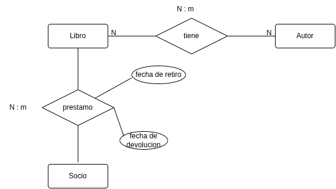
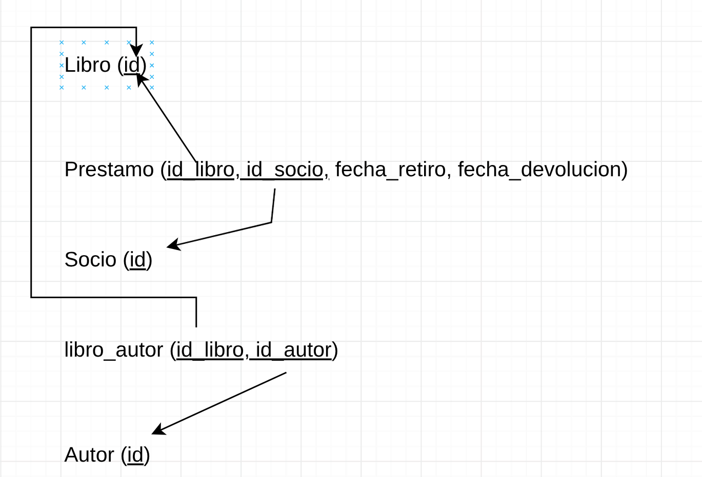

# Ejemplo 1: Sistema de Biblioteca

Una biblioteca registra libros y autores. Un libro puede tener varios autores y un autor varios libros. Los socios toman libros prestados; de cada préstamo interesan la fecha de retiro y la de devolución.



### Modelo relacional 


### Codigo SQL
```sql
CREATE TABLE libro(
    id VARCHAR(5) PRIMARY KEY
);

CREATE TABLE prestamo(
    id_libro VARCHAR(5) NOT NULL,
    id_socio VARCHAR(5) NOT NULL,
    fecha_retiro DATE NOT NULL,
    fecha_devolucion DATE NOT NULL,
    PRIMARY KEY(id_libro, id_socio),
    FOREIGN KEY(id_libro) REFERENCES libro(id),
    FOREIGN KEY(id_socio) REFERENCES socio(id)
);

CREATE TABLE socio (
    id VARCHAR(5) PRIMARY KEY
);

CREATE TABLE libro_autor (
    id_libro VARCHAR(5) NOT NULL,
    id_autor VARCHAR(5) NOT NULL,
    PRIMARY KEY(id_libro, id_autor),
    FOREIGN KEY(id_libro) REFERENCES libro(id),
    FOREIGN KEY(id_autor) REFERENCES autor(id)
);
```