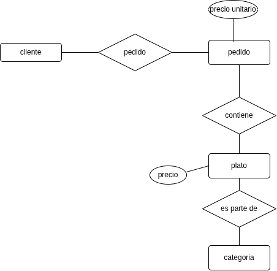
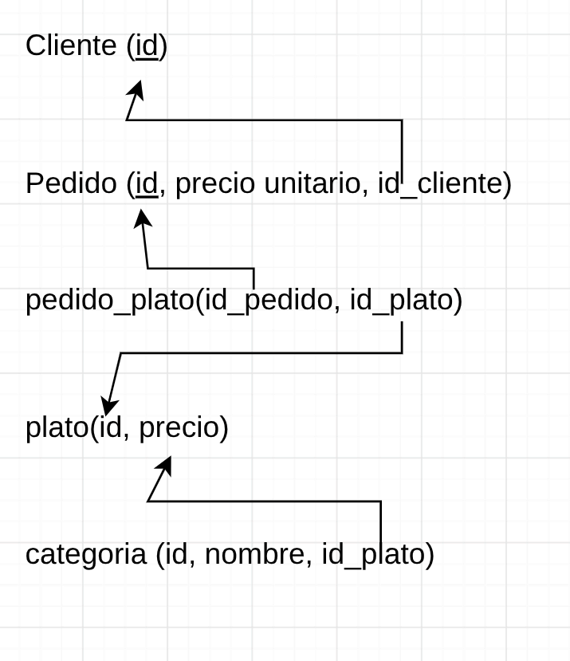

# Ejemplo 2: Pedidos de Restaurante

Los clientes realizan pedidos que contienen varios platos con distinta cantidad. Los platos se agrupan en categorías. Cada pedido lo atiende un único mesero. El precio del plato debe registrarse tal como estaba al momento del pedido, aunque luego cambie.



### Modelo relacional


### Codigo SQL
```sql
CREATE TABLE cliente(
    id VARCHAR(5) PRIMARY KEY
);

CREATE TABLE pedido(
    id VARCHAR(5) PRIMARY KEY,
    precio_unitario FLOAT NOT NULL,
    id_cliente VARCHAR(5) NOT NULL,
    FOREIGN KEY(id_cliente) REFERENCES cliente(id)
);

CREATE TABLE pedido_plato(
    id_pedido VARCHAR(5) NOT NULL,
    id_plato VARCHAR(5) NOT NULL,
    PRIMARY KEY(id_pedido, id_plato),
    FOREIGN KEY(id_pedido) REFERENCES pedido(id),
    FOREIGN KEY(id_plato) REFERENCES plato(id)
);

CREATE TABLE plato(
    id VARCHAR(5) PRIMARY KEY,
    precio FLOAT NOT NULL
);

CREATE TABLE categoria(
    id VARCHAR(5) PRIMARY KEY,
    nombre VARCHAR(20) NOT NULL,
    id_plato VARCHAR(5) NOT NULL,
    FOREIGN KEY(id_plato) REFERENCES plato(id),
)
```