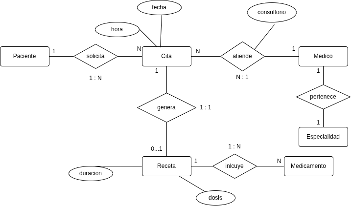

# Ejemplo 3: Clinica Médica

Los pacientes solicitan citas; cada cita la atiende un médico a un paciente en fecha, hora y consultorio. De algunas citas se genera una receta que incluye medicamentos con dosis y duración. Cada médico pertenece a una especialidad.

