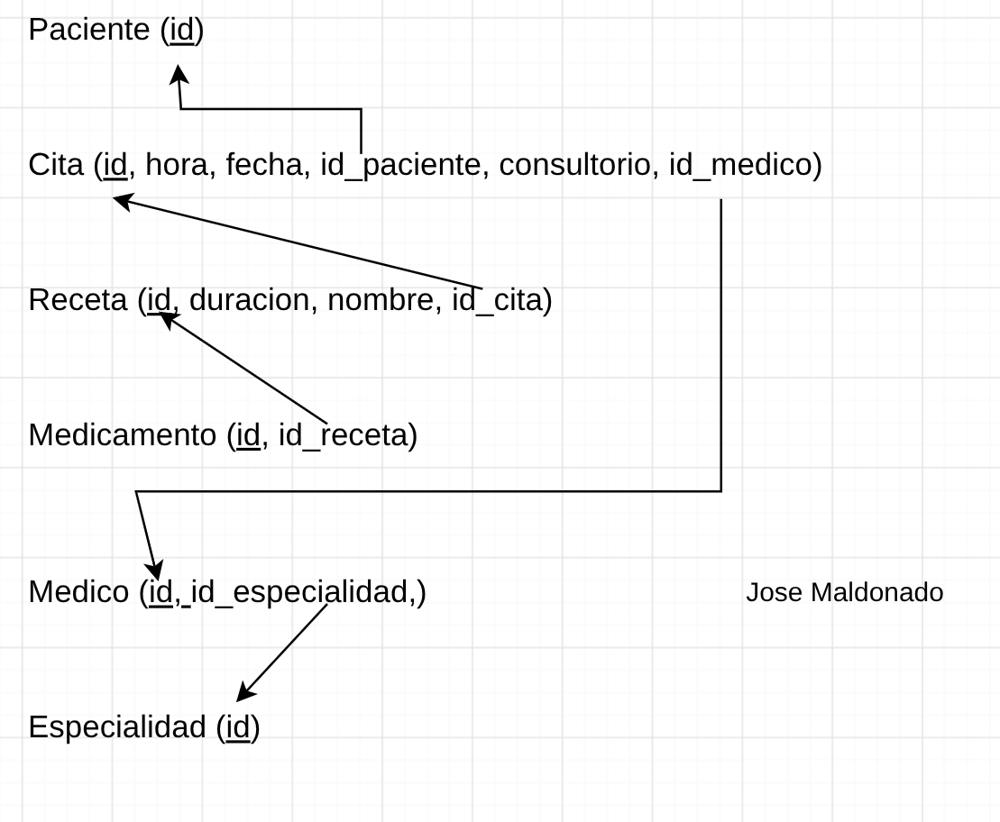

# Ejemplo 3: Clinica Médica

Los pacientes solicitan citas; cada cita la atiende un médico a un paciente en fecha, hora y consultorio. De algunas citas se genera una receta que incluye medicamentos con dosis y duración. Cada médico pertenece a una especialidad.


### Modelo relacional 


### Codigo SQL
```sql
CREATE TABLE paciente (
    id VARCHAR(10) PRIMARY KEY
)

CREATE TABLE cita (
    id VARCHAR(10) PRIMARY KEY,
    hora TIME NOT NULL,
    fecha DATE NOT NULL,
    id_paciente VARCHAR(10) NOT NULL,
    consultorio VARCHAR(30) NOT NULL,
    id_medico VARCHAR(10) NOT NULL,
    FOREIGN KEY(id_medico) REFERENCES medico(id_medico)
);

CREATE TABLE receta (
    id VARCHAR(10) PRIMARY KEY,
    duracion FLOAT NOT NULL,
    nombre VARCHAR(40) NOT NULL,
    id_cita VARCHAR(10) NOT NULL UNIQUE,
    FOREIGN KEY(id_cita) REFERENCES cita(id)
);

CREATE TABLE medicamento (
    id VARCHAR(10) NOT NULL,
    id_receta VARCHAR(10) NOT NULL,
    FOREIGN KEY(id_receta) REFERENCES receta(id)
);

CREATE TABLE medico (
    id VARCHAR(10) NOT NULL,
    id_especialidad VARCHAR(10) NOT NULL,
    FOREIGN KEY(id_especialidad) REFERENCES especialidad(id)
);

CREATE TABLE especialidad (
    id VARCHAR(10) PRIMARY KEY
);
```