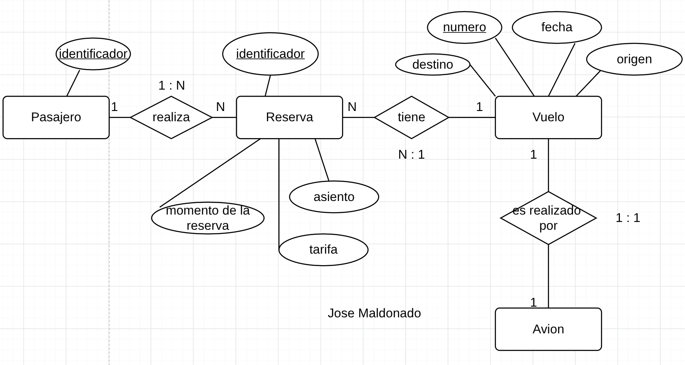
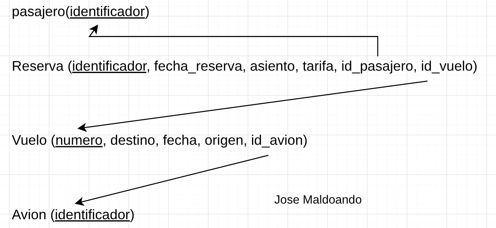

# Ejemplo 4: Sistema de Areolinea
Una aerolínea opera vuelos (cada uno con número, fecha, origen y destino), cada vuelo lo realiza un avión. Los pasajeros realizan reservas para un vuelo específico, indicando asiento y tarifa pagada en el momento de la reserva.



### Modelo relacional


### Codigo SQL
```sql
CREATE TABLE pasajero (
    identificador VARCHAR(10) PRIMARY KEY,
);

CREATE TABLE reserva (
    identificador VARCHAR(10) PRIMARY KEY,
    fecha_reserva DATE NOT NULL,
    asiento VARCHAR(05) NOT NULL,
    tarifa FLOAT NOT NULL,
    id_pasajero VARCHAR(10) NOT NULL,
    id_vuelo VARCHAR(10) NOT NULL,
    FOREIGN KEY(id_pasajero) REFERENCES pasajero(identificador),
    FOREIGN KEY(id_vuelo) REFERENCES vuelo(numero),
);

CREATE TABLE vuelo (
    numero VARCHAR(10) PRIMARY KEY,
    destino VARCHAR(30) NOT NULL,
    fecha_origen DATE NOT NULL,
    id_avion VARCHAR(10) NOT NULL,
    FOREIGN KEY(id_avion) REFERENCES avion(identificador),
);

CREATE TABLE avion (
    identificador VARCHAR(10) PRIMARY KEY,
);

```