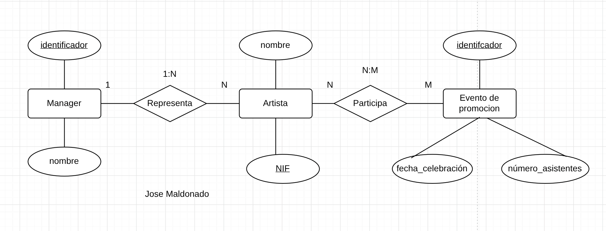
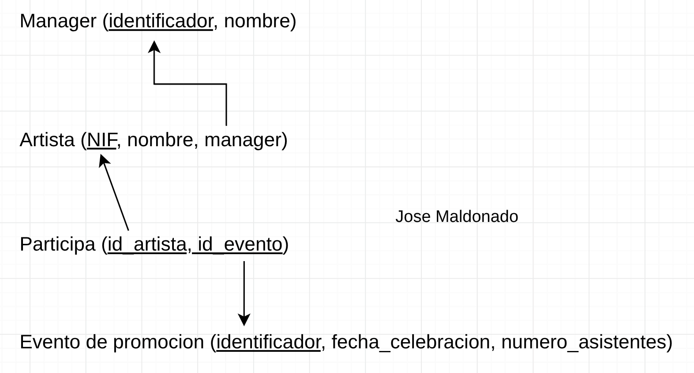

# Ejercicio 5: Empresa Discografica
Una empresa discográfica necesita modelar los datos sobre sus diferentes recursos según
las siguientes características:
● Manager: de cada mánager se almacena un identificador de manager y su nombre. Un
manager representa a una serie de artistas.
● Artista: un artista es representado por un manager. De los artistas se almacena su
nombre completo (usando un único atributo) y su NIF.
● Evento de promoción: los artistas participan en eventos de promoción para dar a
conocer sus trabajos. En un evento de promoción pueden participar varios artistas. De
un evento se almacena un identificador único, la fecha de celebración y el número de
asistentes.


### Modelo relacional


### Codigo SQL
```sql
CREATE TABLE manager (
    identificador VARCHAR(10) PRIMARY KEY,
    nombre VARCHAR(30) NOT NULL,
);

CREATE TABLE artista (
    NIF VARCHAR(10) PRIMARY KEY,
    nombre VARCHAR(30) NOT NULL,
    manager VARCHAR(10) NOT NULL,
    FOREIGN KEY(manager) REFERENCES manager(identificador),
);

CREATE TABLE participa (
    id_artista VARCHAR(10) NOT NULL,
    id_evento VARCHAR(10) NOT NULL,
    PRIMARY KEY(id_artista, id_evento),
    FOREIGN KEY(id_artista) REFERENCES artista(NIF),
    FOREIGN KEY(id_evento) REFERENCES evento(identificador),
);

CREATE TABLE evento_de_promocion (
    identificador VARCHAR(10) PRIMARY KEY,
    fecha_celebracion DATE NOT NULL,
    numero_asistentes INT NOT NULL,
)
```