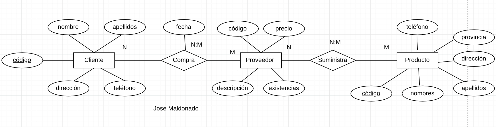
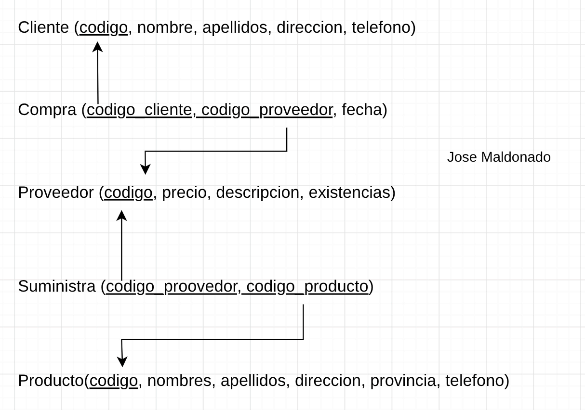

# Ejercicio 6: Tienda Informatica
Se desea crear una aplicación para la gestión de una tienda informática. La tienda dispone de una serie de productos que se venden a los clientes. De cada producto informático se desea guardar el código, descripción, precio y número de existencias. De cada cliente se desea guardar el código, nombre, apellidos, dirección y número telefónico. Un cliente puede comprar varios productos en la tienda y un mismo producto puede ser comprado por varios clientes. Cada vez que se compre un artículo quedará registrada la compra en la base de datos junto con la fecha en la que se compró el artículo. La tienda tiene contactos con varios proveedores que son los que suministran los productos. Un mismo producto puede ser suministrado por varios proveedores. De cada proveedor se desea guardar el código, nombres, apellidos, dirección, provincia y número de teléfono.

### Modelo entidad relacion


### Modelo relacional 


### Codigo SQL
```sql
CREATE TABLE cliente (
    codigo VARCHAR(10) PRIMARY KEY,
    nombre VARCHAR(30) NOT NULL,
    apellidos VARCHAR(30) NOT NULL,
    direcccion text NOT NULL,
    telefono VARCHAR(10) NOT NULL,
);

CREATE TABLE compra (
    codigo_cliente VARCHAR(10) NOT NULL,
    codigo_proveedor VARCHAR(10) NOT NULL,
    fecha DATE NOT NULL,
    PRIMARY KEY(codigo_cliente, codigo_proveedor),
    FOREIGN KEY(codigo_cliente) REFERENCES cliente(codigo),
    FOREIGN KEY(codigo_proveedor) REFERENCES proveedor(codigo),
);

CREATE TABLE proveedor (
    codigo VARCHAR(10) PRIMARY KEY,
    precio FLOAT NOT NULL,
    descripcion text NOT NULL,
    existencias INT NOT NULL,
);

CREATE TABLE suministra (
    codigo_proveedor VARCHAR(10) NOT NULL,
    codigo_producto VARCHAR(10) NOT NULL,
    PRIMARY KEY(codigo_proveedor, codigo_producto),
    FOREIGN KEY(codigo_proveedor) REFERENCES proveedor(codigo),
    FOREIGN KEY(codigo_producto) REFERENCES producto(codigo),
);

CREATE TABLE producto (
    codigo VARCHAR(10) PRIMARY KEY,
    nombres VARCHAR(30) NOT NULL,
    apellidos VARCHAR(30) NOT NULL,
    direccion text NOT NULL,
    provincia VARCHAR(20)NOT NULL,
    telefono VARCHAR(10) NOT NULL,
);
```