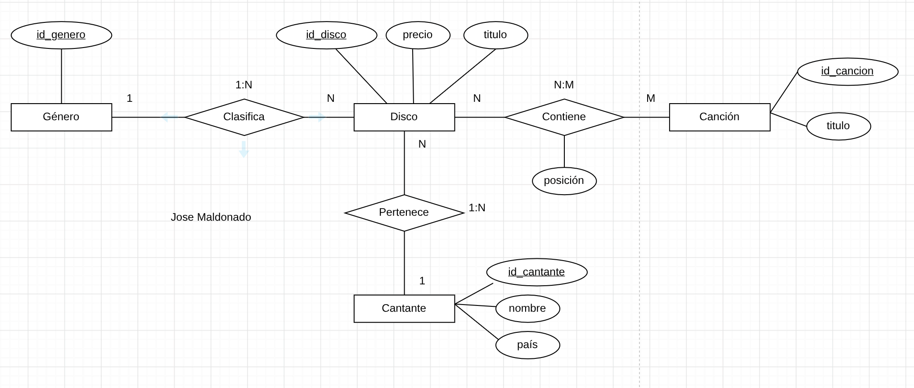
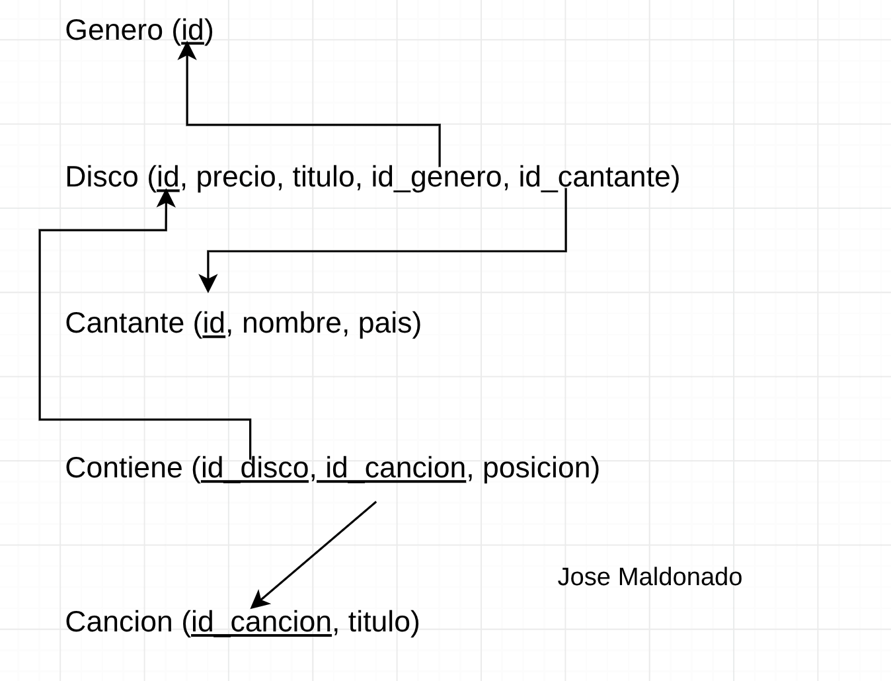

# Ejercicio 7: Discos Musicales
La tienda vende discos de diferentes géneros musicales y cantantes
Cada género musical tiene un identificador
Cada disco tiene titulo, genero musical, precio y cantante
De un cantante se registra el nombre y su país, Todo disco pertenece a un cantante y un cantante puede tener muchos discos. Además un disco tiene un conjunto de canciones(identificador y título)
Un disco tiene muchas canciones y una canción puede estar en varios discos. Interesa conocer la posición de una canción en un determinado disco.


### Modelo relacional


### Codigo SQL
```sql
CREATE TABLE genero(
    id VARCHAR(5) PRIMARY KEY
);

CREATE TABLE disco(
    id VARCHAR(5) PRIMARY KEY,
    precio FLOAT  NOT NULL,
    titulo VARCHAR(30) NOT NULL,
    id_genero VARCHAR(5) NOT NULL, 
    id_cantante VARCHAR(5) NOT NULL,
    FOREIGN KEY(id_genero) REFERENCES genero(id),
    FOREIGN KEY(id_cantante) REFERENCES genero(id)
);

CREATE TABLE cantante(
    id VARCHAR(5) PRIMARY KEY,
    nombre VARCHAR(30) NOT NULL,
    pais VARCHAR(30) NOT NULL
);

CREATE TABLE contiene(
    id_disco VARCHAR(5) NOT NULL,
    id_cancion VARCHAR(5)  NOT NULL,
    posicin INT NOT NULL,
    PRIMARY KEY(id_disco, id_cancion),
    FOREIGN KEY(id_disco) REFERENCES disco(id),
    FOREIGN KEY(id_cancion) REFERENCES cancion(id_cancion)
);

CREATE TABLE cancion(
    id_cancion VARCHAR(5) PRIMARY KEY,
    tiutlo VARCHAR(30) NOT NULL
);
```