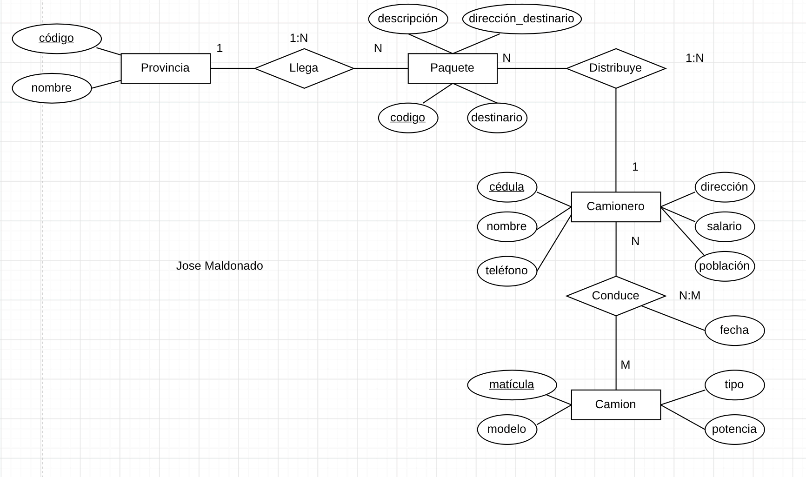
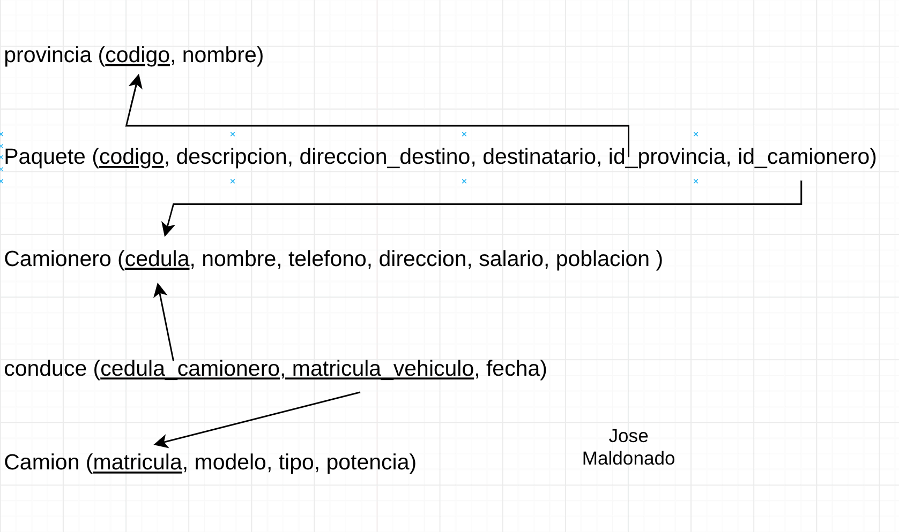

# Ejercicio 8: Camiones
Se desea informatizar la gestión de una empresa de transporte que reparte paquetes por toda España. Los enio.cargados de llevar los paquetes son los camioneros, de los que se quiere guardar la cédula, nombre, teléfono, dirección, salario y población en que vive. De los paquetes transportados interesa conocer el código del paquete, descripción, destinatario y dirección del destinatar
Un camionero distribuye muchos paquetes, y un paquete sólo puede ser distribuido por un camionero. De las provincias a las que llegan los paquetes interesa guardar el código de provincia y el nombre. Un paquete sólo puede llegar a una provincia. Sin embargo, a una provincia pueden llegar varios paquetes.
De los camiones que llevan los camioneros, interesa conocer la matrícula, modelo, tipo y potencia. Un camionero puede conducir diferentes camiones en fechas diferentes, y un camión puede ser conducido por varios camioneros.


### Modelo relacional


### Codigo SQL
```sql
CREATE TABLE provincia (
    codigo VARCHAR(5) PRIMARY KEY,
    nombre VARCHAR(5) NOT NULL
);

CREATE TABLE paquete (
    codigo VARCHAR(5) PRIMARY KEY,
    descripcion TEXT NOT NULL,
    direccion_destino TEXT NOT NULL,
    destinatario VARCHAR(30) NOT NULL,
    id_provincia VARCHAR(5) NOT NULL,
    id_camionero VARCHAR(10) NOT NULL,
    FOREIGN KEY(id_provincia) REFERENCES provincia(codigo),
    FOREIGN KEY(id_camionero) REFERENCES camioner(cedula)
);

CREATE TABLE camionero (
    cedula varchar(10) PRIMARY KEY,
    nombre VARCHAR(30) NOT NULL,
    telefono VARCHAR(10) NOT NULL,
    direcccion TEXT NOT NULL,
    salario FLOAT NOT NULL,
    poblacion VARCHAR(30) NOT NULL,
)

CREATE TABLE conduce (
    cedula_camionero VARCHAR(10) NOT NULL,
    matricula_vehiculo VARCHAR(8) NOT NULL,
    PRIMARY KEY(cedula_camionero, matricula_vehiculo),
    FOREIGN KEY(cedula_camionero) REFERENCES camionero(cedula),
    FOREIGN KEY(matricula_vehiculo) REFERENCES camion(matricula)
);

CREATE TABLE camion (
    matricula VARCHAR(8) PRIMARY KEY,
    modelo VARCHAR(30) NOT NULL,
    tipo VARCHAR(20) NOT NULL,
    potencia FLOAT NOT NULL
);
```