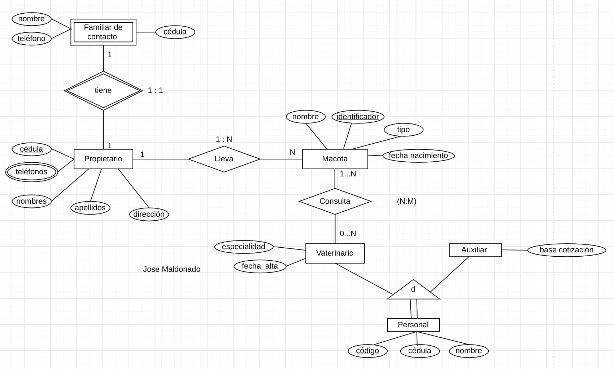
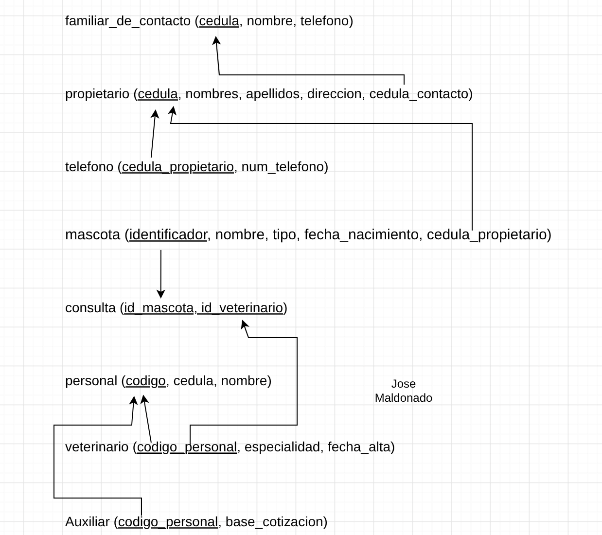

# Ejercicio 9: Veterinaria
* Del propietario interesa: cédula, apellidos, nombres, dirección , teléfonos
* De la mascota interesa: identificador, nombre, fecha de nacimiento, tipo
* Un propietario puede llevar una o varias mascotas
* Una mascota la lleva uno y solo un propietario
* Del personal de la clínica veterinaria interesa un código, el cédula, nombre
* Entre el personal de la clínica se distingue a los veterinarios y los auxiliares, pudiendo haber otros tipos:
    * Del veterinario se guarda además su fecha_alta y especialidad
    * De los auxiliares interesa su base de cotización
* Las mascotas pasan consulta con los veterinarios. De manera que:
    * un veterinario puede pasar consulta a ninguna o a varias mascotas, y
    * una misma mascota de la clínica ha pasado consulta una o más veces en fechas diferentes con   varios veterinarios.
    * Al pasar consulta se realiza un diagnóstico.
* Cada propietario tiene un familiar de contacto para casos de emergencia.
    * De este familiar interesa la cédula, nombre y teléfono.
    * Si el propietario se da de alta en la clínica veterinaria, el familiar ya no interesa.
    * El familiar es contacto de un solo propietario

### Modelo entidad - relacion


### Modelo relacional


### Codigo SQL
```sql
CREATE TABLE familiar_de_contacto(
    cedula VARCHAR(10) PRIMARY KEY,
    nombre VARCHAR(40) NOT NULL,
    telefono VARCHAR(10) NOT NULL
);

CREATE TABLE propietario(
    cedula VARCHAR(10) PRIMARY KEY,
    nombres VARCHAR(40) NOT NULL,
    apellidos VARCHAR(40) NOT NULL,
    direccion text NOT NULL,
    cedula_contacto VARCHAR(10) NOT NULL,
    FOREIGN KEY(cedula_contacto) REFERENCES familiar_de_contacto(cedula)
);

CREATE TABLE telefono(
    cedula_propietario VARCHAR(10) PRIMARY KEY,
    num_telefono VARCHAR(10) NOT NULL,
    FOREIGN KEY(cedula_propietario) REFERENCES propietario(cedula)
);

CREATE TABLE mascota(
    identificador VARCHAR(5) PRIMARY KEY,
    nombre VARCHAR(40) NOT NULL,
    tipo VARCHAR(30),
    fecha_nacimiento DATE NOT NULL,
    cedula_propietario VARCHAR(10) NOT NULL,
    FOREIGN KEY(cedula_propietario) REFERENCES propietario(cedula)
);

CREATE TABLE consulta(
    id_mascota VARCHAR(5) NOT NULL,
    id_veterianrio VARCHAR(5) NOT NULL,
    PRIMARY KEY(id_mascota, id_veterianrio),
    FOREIGN KEY(id_mascota) REFERENCES mascota(identificador),
    FOREIGN KEY(id_veterianrio) REFERENCES veterinario(codigo_personal)
);

CREATE TABLE personal(
    codigo VARCHAR(5) PRIMARY KEY,
    cedula VARCHAR(10) NOT NULL,
    nombre VARCHAR(40) NOT NULL
);

CREATE TABLE veterinario(
    codigo_personal VARCHAR(5) PRIMARY KEY,
    especialidad VARCHAR(40),
    fecha_alta DATE NOT NULL,
    FOREIGN KEY(codigo_personal) REFERENCES personal(codigo) 
);

CREATE TABLE auxiliar(
    codigo_personal VARCHAR PRIMARY KEY,
    base_cotizacion FLOAT NOT NULL,
    FOREIGN KEY(codigo_personal) REFERENCES personal(codigo)
);
```