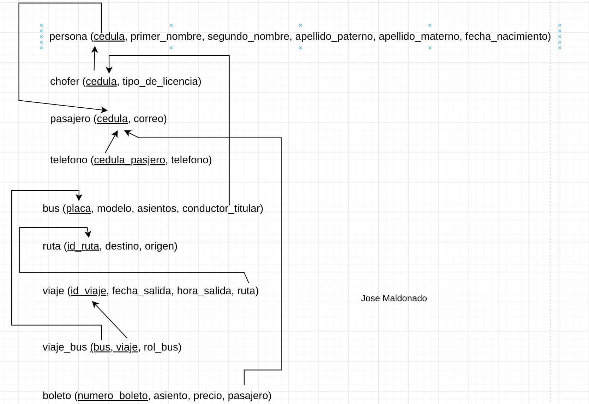

# Ejercicio en clase
Caso de Uso: ¿Cómo funciona el día a día en nuestra cooperativa?
"En la cooperativa atendemos a dos tipos de personas: a nuestros pasajeros y a los choferes. De cualquiera que entra al sistema necesitamos sus datos básicos: nombres y apellidos completos (separando bien el primero y el segundo de cada uno) y la fecha de nacimiento para saber si aplica descuento de tercera edad o menor de edad.

Ahora, no les pedimos lo mismo a todos. Al chofer le registramos el número y tipo de licencia profesional, porque sin eso no puede salir a carretera. Al pasajero le pedimos su correo para mandarle el comprobante digital y al menos un número de teléfono celular, aunque muchos nos dejan dos o tres teléfonos por si acaso no contesten ante cualquier emergencia durante el viaje.

Por otro lado, está la flota de buses. Cada unidad tiene su placa, modelo y el número total de asientos disponibles. En la empresa tenemos una regla clara: cada bus tiene un único chofer titular fijo que responde por esa máquina, y ese chofer no puede ser titular de otro bus al mismo tiempo.

Manejamos varias rutas fijas entre terminales terrestres, como Quito - Loja o Guayaquil - Cuenca, con su distancia en kilómetros. Para cubrir esas rutas, armamos los turnos o viajes del día y la semana, fijando la fecha y la hora exacta de salida.

Cuando hay temporada baja, un viaje sale con su bus asignado normalmente. Pero en feriados o fines de año la demanda revienta, así que a un mismo viaje le asignamos dos o más buses: el titular que va adelante y los de refuerzo que salen detrás. En el sistema registramos cuándo se despachó cada bus y si salió como titular o apoyo.

Finalmente, está la venta de pasajes. Cada vez que abrimos un turno de viaje, se empiezan a emitir los boletos para ese recorrido. Un boleto no existe en el aire: siempre pertenece a un viaje en particular, lleva un número secuencial de boleto propio de esa salida, el número de asiento que escogió el cliente, el precio cobrado y, por supuesto, los datos del pasajero que va a viajar para chequearlo antes de subir al bus."

